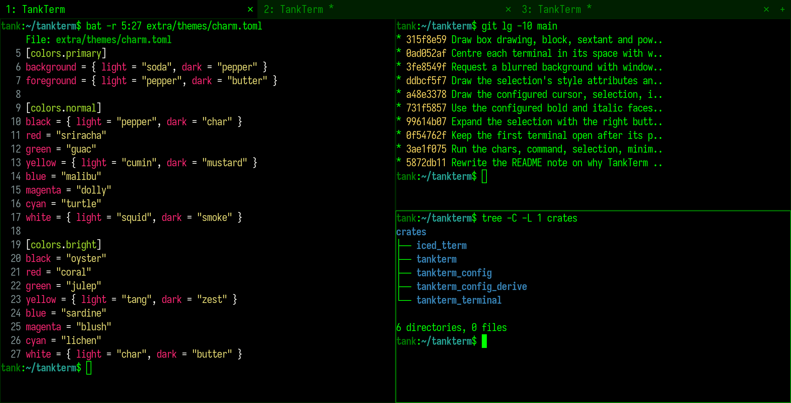

    

<h1 align="center">TankTerm - A fast, cross-platform, OpenGL terminal emulator</h1>

<i>"Tank, I need an exit."</i>

> [!NOTE]
> TankTerm is a fork of [Alacritty](https://github.com/alacritty/alacritty). It contains code
> generated by large language models, which upstream Alacritty does not accept, hence the fork.
> LLM-generated changes here are tested and reviewed by a human before they are merged; see
> [CONTRIBUTING.md](./CONTRIBUTING.md#llmai-contributions). Please report problems with TankTerm
> here, not to the upstream Alacritty project.
>
> The command is `tankTerm`. TankTerm keeps using the `alacritty` terminfo.

  

## About

TankTerm is a modern terminal emulator that comes with sensible defaults, but
allows for extensive [configuration](#configuration). By integrating with other
applications, rather than reimplementing their functionality, it manages to
provide a flexible set of [features](./docs/features.md) with high performance.
The supported platforms currently consist of BSD, Linux, macOS and Windows.

The software is considered to be at a **beta** level of readiness; there are
a few missing features and bugs to be fixed, but it is already used by many as
a daily driver.

### iced front end

TankTerm's window and rendering now use the [iced](https://iced.rs) GUI toolkit
through [iced_tterm](./crates/iced_tterm), replacing Alacritty's
OpenGL front end. The terminal itself (escape sequences, the grid and the PTY)
is still the `tankterm_terminal` crate. The font, colors, shell, environment,
working directory, the window's title, class, size, position, startup mode,
decorations and level, the `[scrolling]` and `[cursor]` options and the key
bindings for tabs, panes, copying and pasting, the font size, scrolling and
fullscreen are read from your configuration.

This front end is new and doesn't support everything the OpenGL one did yet:

- IPC (`tankTerm msg`, `--socket`) and `--daemon`
- Live config reload
- Hints, vi mode and search, with the key binding actions that need them
- Key bindings to `command` and `chars` and to `Quit`, `Hide`, `Minimize`, `ClearSelection`,
  `CopySelection`, `SpawnNewInstance` and `CreateNewWindow`; mouse bindings other than pasting
- `window.opacity` and `window.blur`, and most `[mouse]` and `[bell]` options
- `--hold`

Command line options that aren't supported yet fail with an error; config
options that aren't supported yet are ignored.

## Features

You can find an overview over the features available in TankTerm [here](./docs/features.md).

## Further information

Background on Alacritty, which TankTerm is based on:

- [Announcing Alacritty, a GPU-Accelerated Terminal Emulator](https://jwilm.io/blog/announcing-alacritty/) January 6, 2017
- [A talk about Alacritty at the Rust Meetup January 2017](https://www.youtube.com/watch?v=qHOdYO3WUTk) January 19, 2017
- [Alacritty Lands Scrollback, Publishes Benchmarks](https://jwilm.io/blog/alacritty-lands-scrollback/) September 17, 2018

## Installation

TankTerm has to be built from source. The detailed instructions to build and
install it can be found [here](INSTALL.md).

### Requirements

- A GPU supported by [wgpu](https://wgpu.rs) (Vulkan, Metal, DirectX 12 or
  OpenGL ES 3); iced falls back to software rendering otherwise
- [Windows] ConPTY support (Windows 10 version 1809 or higher)

## Configuration

You can find the documentation for TankTerm's configuration in `man 5
tankTerm`, or in [its source](./extra/man/tankTerm.5.scd) if you do not have
the manpages installed.

TankTerm doesn't create the config file for you, but it looks for one in the
following locations:

1. `$XDG_CONFIG_HOME/tankterm/tankterm.toml`
2. `$XDG_CONFIG_HOME/tankterm.toml`
3. `$HOME/.config/tankterm/tankterm.toml`
4. `$HOME/.tankterm.toml`
5. `/etc/tankterm/tankterm.toml`

On Windows, the config file will be looked for in:

- `%APPDATA%\tankterm\tankterm.toml`

Themes are selected with `theme = "<name>"` in the configuration, `--theme`
or `TANKTERM_THEME`: `green_screen` (default), `charm`, `dracula`,
`catppuccin` and `base16` are built in, and any other value is a path to a
theme file like the ones in [`extra/themes`](./extra/themes).

## Contributing

A guideline about contributing to TankTerm can be found in the
[`CONTRIBUTING.md`](CONTRIBUTING.md) file.

## FAQ

**_Is it really the fastest terminal emulator?_**

Benchmarking terminal emulators is complicated. TankTerm uses
[vtebench](https://github.com/alacritty/vtebench) to quantify terminal emulator
throughput and manages to consistently score better than the competition using
it. If you have found an example where this is not the case, please report a
bug.

Other aspects like latency or framerate and frame consistency are more difficult
to quantify. Some terminal emulators also intentionally slow down to save
resources, which might be preferred by some users.

If you have doubts about TankTerm's performance or usability, the best way to
quantify terminal emulators is always to test them with **your** specific
usecases.

**_Why isn't feature X implemented?_**

TankTerm has many great features, but not every feature from every other
terminal. This could be for a number of reasons, but sometimes it's just not a
good fit for TankTerm. This means you won't find things like tabs or splits
(which are best left to a window manager or [terminal multiplexer][tmux]) nor
niceties like a GUI config editor.

[tmux]: https://github.com/tmux/tmux

## License

TankTerm, like Alacritty, is released under the [Apache License, Version 2.0].

[Apache License, Version 2.0]: ./LICENSE-APACHE
